## Introduction

`enetLTS` fits **robust and sparse** linear, logistic and multinomial regression
models. It combines the trimming idea of the Least Trimmed Squares (LTS)
estimator with the elastic net penalty, so that a few outlying observations
cannot spoil the fit, while the penalty selects variables and handles
correlated and high-dimensional predictors ($p > n$).

For $h \le n$ observations, the estimator minimizes the penalized loss over the
best subset $H$ of size $h$,

$$
Q(H,\beta) = \sum_{i \in H} \ell_i(\beta) + h\lambda P_\alpha(\beta),
\qquad
P_\alpha(\beta) = \frac{1-\alpha}{2}\|\beta\|_2^2 + \alpha\|\beta\|_1 ,
$$

where $\ell_i$ is half the squared residual (linear) or the negative
log-likelihood contribution (logistic, multinomial), so that $\lambda$ has the
same scale as in `glmnet` (Kurnaz, Hoffmann and Filzmoser (2018) write the
linear loss without the factor $1/2$, which doubles the scale of $\lambda$).

The subset $H$ is searched with concentration steps (C-steps) from many small
starting subsets: each C-step fits the elastic net on the current subset and keeps
the $h$ observations that fit it best. These are the observations with the
smallest loss (linear regression; logistic regression within each class, so that
the class proportions are kept) or with the smallest robust distance within their
class (multinomial regression, see the section on the multinomial model). For
logistic regression, the best starting subsets are chosen with the robust
Bianco-Yohai criterion of Croux and Haesbroeck (2003), as in Kurnaz, Hoffmann and
Filzmoser (2018). A final **reweighting step** raises the efficiency. The tuning parameters $\alpha$ and $\lambda$ are chosen by
cross-validation, and the elastic net fits themselves are computed with the
`glmnet` package (Friedman, Hastie and Tibshirani, 2010).

The package at a glance:

| Task | Function |
|---|---|
| Fit the model | `enetLTS(x, y, family = ...)` |
| Summary, coefficients | `print()`, `coef()`, `nonzeroCoef.enetLTS()` |
| Flagged observations | `outliers.enetLTS()`, `weights()` |
| Predictions | `predict()`, `fitted()`, `residuals()` |
| Plots | `plotCoef.enetLTS()`, `plotResid.enetLTS()`, `plotDiagnostic.enetLTS()` |
| Performance on test data | `assess.enetLTS()`, `confusion.enetLTS()`, `roc.enetLTS()` |

Three simulated data sets with known outliers, `GaussianExample`,
`BinomialExample` and `MultinomialExample`, are used below; all of them are
high-dimensional ($p > n$).

## Installation


```r
install.packages("enetLTS")
```


```r
library(enetLTS)
```

## Quick start

We load a data set with $n = 100$ observations and $p = 200$ predictors, of which
the first 10 observations are outliers, and fit the model with the default
settings. `seed` makes the random starting subsets, and therefore the result,
reproducible.


```r
data(GaussianExample)
x <- GaussianExample$x
y <- GaussianExample$y
dim(x)
#> [1] 100 200
```


```r
fit <- enetLTS(x, y, seed = 1)
```

Printing the fit shows the nonzero coefficients (at most `maxprint` of them), the
selected tuning parameters and the number of observations flagged as outliers:


```r
fit
#> enetLTS estimator (family = "gaussian", reweighted fit)
#> 
#> Call: enetLTS(xx = x, yy = y, seed = 1)
#> 
#> Nonzero coefficients (35 of 200 predictors):
#> (Intercept)          x1          x2          x3          x4          x5 
#>      1.1590      0.7691      0.7048      0.6734      1.4873      1.0187 
#>          x6          x7          x8          x9         x10         x11 
#>      0.6019      0.8707      1.8722      0.3109      1.2145      0.5719 
#>         x12         x13         x14         x15         x16         x17 
#>      1.3227      0.6547      0.6478      1.6695      0.3159      1.5570 
#>         x18         x19 
#>      0.9101      0.9740 
#> ... 16 more; see coef(x)
#> 
#> alpha = 0.65, lambda = 0.2463, lambdaw = 0.1594
#> Observations flagged as outliers: 15 of 100 (see outliers.enetLTS())
```

The flagged observations, with their absolute residuals (`loss`) and fitted values:


```r
outliers.enetLTS(fit)
#> enetLTS outliers (reweighted fit, gaussian): 15 of 100 observations flagged
#>  index    loss observed predicted    type
#>      1 256.226  635.593   379.367 outlier
#>      2 255.365  636.414   381.049 outlier
#>      3 255.126  624.066   368.940 outlier
#>      4 255.921  640.200   384.279 outlier
#>      5 256.717  635.644   378.927 outlier
#>      6 254.164  634.995   380.831 outlier
#>      7 255.416  628.734   373.318 outlier
#>      8 255.072  630.754   375.682 outlier
#>      9 256.706  631.616   374.910 outlier
#>     10 257.744  638.528   380.784 outlier
#>     14   2.461  -34.244   -31.783 outlier
#>     22   1.910   24.300    22.390 outlier
#>     41   2.931    0.986    -1.945 outlier
#>     58   3.286  -14.045   -10.759 outlier
#>     84   3.314  -11.911    -8.597 outlier
```

Predictions for new observations:


```r
predict(fit, newX = GaussianExample$xtest[1:5, ], type = "response")
#> $response
#> [1]  4.572018 10.274609 -5.736091 20.673360 -7.849757
```

The rest of this vignette explains these steps for every family.

## Linear regression: `family = "gaussian"` (default)

### The model

The linear model is $y_i = \beta_0 + x_i^\top\beta + \varepsilon_i$. enetLTS keeps
the $h$ observations with the smallest squared residuals and minimizes

$$\min_{|H|=h}\ \Big\{\frac12\sum_{i\in H}(y_i-\beta_0-x_i^\top\beta)^2 + h\lambda P_\alpha(\beta)\Big\}.$$

The intercept is not penalized. For $\alpha=1$ this is the sparse LTS estimator of
Alfons, Croux and Gelper (2013).

### The data

`GaussianExample` follows the simulation design of Kurnaz, Hoffmann and
Filzmoser (2018). The first 20 predictors are informative ($\beta_j = 1$) and
highly correlated within two blocks; the other 180 are noise. For the first 10
observations the informative predictors are drawn from $N(20, 1)$ and the
response is shifted far up, so they are leverage points and vertical outliers
at the same time (see `?GaussianExample`). The data also contain a clean test
set.

### Raw and reweighted estimates

Each estimate comes in two versions. The **raw** estimator minimizes the trimmed
penalized criterion and is the initial robust fit. The **reweighted** estimator
(the default) aims at a higher statistical efficiency: it refits the model on the
observations that are consistent with the raw fit and flags only those that are
clearly inconsistent with the refitted model. The two versions can differ in the
coefficients, the selected variables and the flagged observations; an observation
trimmed by the raw fit is not guaranteed to be flagged by the reweighted fit. Use
`vers = "raw"` in `coef()`, `predict()`, `outliers.enetLTS()`, the plots and the
assessment functions to obtain the raw version.


```r
b  <- coef(fit)                         # intercept first
br <- coef(fit, vers = "raw")
c(reweighted = sum(b[-1] != 0), raw = sum(br[-1] != 0))
#> reweighted        raw 
#>         35         33
```

The true model has 20 nonzero slopes. The reweighted fit selects
20 of them and 15 noise variables.

### Outliers

`outliers.enetLTS()` returns one row per observation; its print method shows only
the flagged ones, and the indices are the `index` entries with `flagged == TRUE`.
Since we know the contaminated observations, we can check the result:


```r
o   <- outliers.enetLTS(fit)
fl  <- o$index[o$flagged]
out <- GaussianExample$outliers
list(flagged = fl,
     detected = intersect(fl, out),
     missed = setdiff(out, fl),
     clean_but_flagged = setdiff(fl, out))
#> $flagged
#>  [1]  1  2  3  4  5  6  7  8  9 10 14 22 41 58 84
#> 
#> $detected
#>  [1]  1  2  3  4  5  6  7  8  9 10
#> 
#> $missed
#> integer(0)
#> 
#> $clean_but_flagged
#> [1] 14 22 41 58 84
```

10 of the 10 contaminated observations
are flagged. The clean observations in the last line are flagged because their
standardized residual exceeds the cut-off `qnorm(1 - del)` = 2.24
of the reweighting step. With normal errors this happens by chance for about
`2*del` = 2.5% of the clean observations, here about
2.2 of 90;
5 were flagged. Their absolute residuals (the `loss` column
above) are small compared with those of the outliers. The
next section shows how `crossfit = TRUE` reduces such false alarms.

The argument `del` controls this trade-off: a smaller value flags fewer clean
observations, but also makes it easier for real outliers to stay unflagged.


```r
fit.del <- enetLTS(x, y, del = 0.005, seed = 1)
```

### Commonly used arguments

`enetLTS()` is the fitting function for all families. The arguments below are
used by every family; the family-specific ones are listed in the sections on
logistic and multinomial regression.

| Argument | Default | Meaning |
|---|---|---|
| `family` | `"gaussian"` | `"gaussian"`, `"binomial"` or `"multinomial"`. |
| `alphas` | `seq(0, 1, length = 41)` | Grid of the elastic net mixing parameter $\alpha$ ($\alpha = 1$ lasso, $\alpha = 0$ ridge). |
| `lambdas` | family-specific grid | Grid of the penalty parameter $\lambda$ for the trimmed (raw) fit. |
| `lambdaw` | chosen by cross-validation | Penalty parameter of the reweighted fit. |
| `hsize` | `0.75` | Fraction of observations kept; up to about $1-$`hsize` of the data may be contaminated. |
| `nsamp` | `c(500, 10)` | Number of elemental starting subsets, and how many of the best are iterated to convergence. |
| `nfold`, `repl` | `5`, `1` | Folds and repetitions of the cross-validation for $\alpha$ and $\lambda$. |
| `del` | `0.0125` | Cut-off of the reweighting step. For linear regression with normal errors about a share `2*del` (2.5%) of clean observations would be flagged; in practice, and for the other families, the share can be higher. |
| `intercept`, `scal` | `TRUE`, `TRUE` | Include an intercept; standardize the predictors (mean and standard deviation) on each subset. |
| `ncores` | `1` | Number of cores for parallel computation. The random starts are drawn in the main process, so the results should not depend on it. |
| `seed` | `NULL` | Makes the random starts, and therefore the results, reproducible. |

For the gaussian family the default `lambdas` grid runs from `lambda0`, a value
derived from robust (winsorized) correlations between the response and each
predictor, down to zero.

**Example: `crossfit = TRUE`.** With cross-fitting, the observations kept by the
trimmed fit are chosen by cross-fitted residuals, so that an observation is never
judged by a model that has seen it. For the gaussian family it is off by default.
On our data:


```r
fit.cf <- enetLTS(x, y, crossfit = TRUE, seed = 1)
ocf <- outliers.enetLTS(fit.cf)
flcf <- ocf$index[ocf$flagged]
list(detected = intersect(flcf, out), clean_but_flagged = setdiff(flcf, out))
#> $detected
#>  [1]  1  2  3  4  5  6  7  8  9 10
#> 
#> $clean_but_flagged
#> [1] 14 84
sapply(list(default = fit, crossfit = fit.cf), function(f)
  assess.enetLTS(f, GaussianExample$xtest, GaussianExample$ytest, vers = "reweighted")$rmse)
#>  default.reweighted crossfit.reweighted 
#>            1.511869            1.370049
```

All outliers are still flagged, fewer clean observations are flagged
(2 instead of 5), and the
test error is smaller. In simulations with this design (6 data sets) both settings
flagged all contaminated observations, and `crossfit = TRUE` flagged fewer clean
observations on average (1.2 against 2.7) with a slightly smaller test error. For
high-dimensional data, `crossfit = TRUE` is therefore worth trying.

A smaller `hsize` gives more protection and less efficiency; for example, if up to
40% of the data could be outlying:


```r
fit60 <- enetLTS(x, y, hsize = 0.6, seed = 1)
```

Parallel computation:


```r
fit.par <- enetLTS(x, y, ncores = 4, seed = 1)
```

### Prediction

`predict()` returns a list. `type = "response"` gives the predicted values;
`type = "coefficients"` and `type = "nonzero"` return the coefficients and the
indices of the nonzero ones. `fitted()` and `residuals()` work on the training
data.


```r
head(predict(fit, newX = GaussianExample$xtest, type = "response")$response)
#> [1]  4.5720180 10.2746086 -5.7360913 20.6733599 -7.8497572  0.8056075
```

### Plots

`plotCoef.enetLTS()` shows every slope as a needle from zero, with a point for
the nonzero ones; the intercept and the number of nonzero slopes are given in the
subtitle. The 20 informative predictors are the first 20; the needles further
right are noise variables with small coefficients.


```r
plotCoef.enetLTS(fit)
```

<div class="figure">
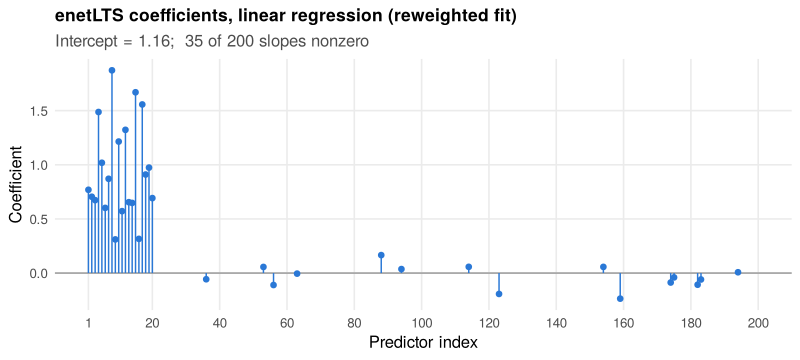
<p class="caption">plot of chunk gaus-coef</p>
</div>

`plotResid.enetLTS()` draws two plots: the standardized residuals against the
observation index and against the fitted values $x_i^\top\hat\beta$. Flagged
observations are red triangles; the gray lines at $\pm$`qnorm(1 - del)` are the
cut-offs of the reweighting step, so the points outside them are exactly the
flagged observations. The ten outliers have standardized residuals far beyond
the cut-offs, so the plot gets a second panel that zooms in on the regular observations and on
the flagged observations close to them; there, the cut-off lines and the few
clean observations just outside them are visible.

Both `plotResid.enetLTS()` and `plotDiagnostic.enetLTS()` add such a zoom panel
automatically when the flagged observations are far away from the regular ones
(`zoom = TRUE`, the default). To save space, this vignette shows it here and for
the logistic diagnostic plot below, and draws the other plots with
`zoom = FALSE`.


```r
plotResid.enetLTS(fit)
```

<div class="figure">
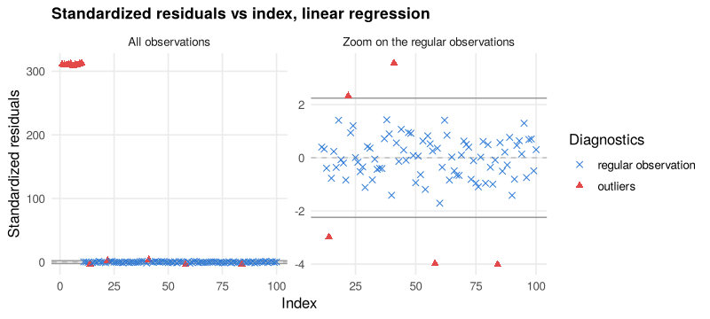
<p class="caption">plot of chunk gaus-resid</p>
</div><div class="figure">
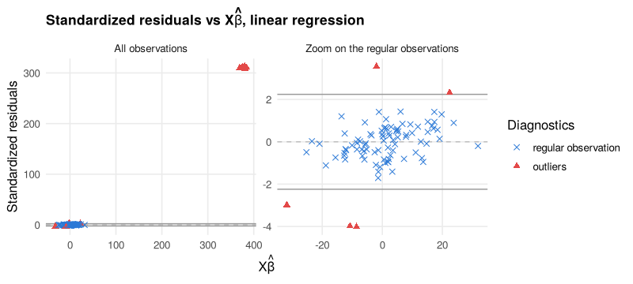
<p class="caption">plot of chunk gaus-resid</p>
</div>

`plotDiagnostic.enetLTS()` plots the response against the fitted values, with the
identity line. The regular observations lie close to the line; the outliers lie far
above it.


```r
plotDiagnostic.enetLTS(fit, zoom = FALSE)
```

<div class="figure">
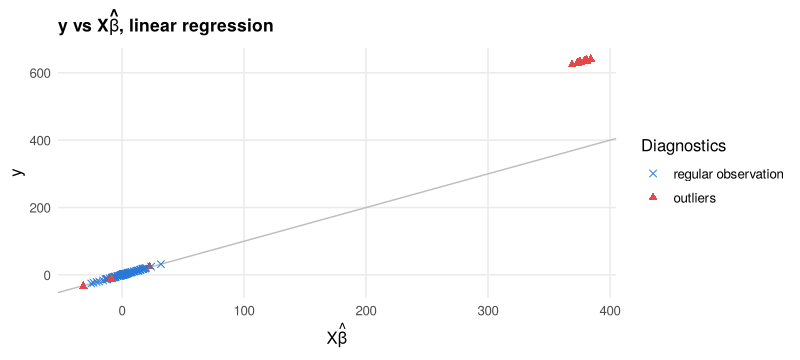
<p class="caption">plot of chunk gaus-diag</p>
</div>

### Assessing the model on test data

`assess.enetLTS()` computes performance measures on new data, for the reweighted
and the raw fit side by side, in the layout of `glmnet::assess.glmnet` (Hastie, Qian
and Tay, 2026):


```r
assess.enetLTS(fit, GaussianExample$xtest, GaussianExample$ytest)
#> $mse
#> reweighted        raw 
#>   2.285748   2.995265 
#> attr(,"measure")
#> [1] "Mean-Squared Error"
#> 
#> $rmse
#> reweighted        raw 
#>   1.511869   1.730683 
#> attr(,"measure")
#> [1] "Root Mean-Squared Error"
#> 
#> $mae
#> reweighted        raw 
#>   1.211453   1.336816 
#> attr(,"measure")
#> [1] "Mean Absolute Error"
```

The errors of the test data have standard deviation 1, so a root mean squared
error close to 1 means that the model predicts about as well as possible. In
simulations with this design (6 data sets), all contaminated observations were
flagged in every data set, and the test root mean squared error was about 1.4 for
enetLTS and about 7 for the classical elastic net (fitted with `glmnet`), which
the outliers pull away from the clean data.

## Logistic regression: `family = "binomial"`

### The model

With $y_i \in \{0, 1\}$, $\eta_i = \beta_0 + x_i^\top\beta$ and
$\pi_i = \Pr(y_i = 1\mid x_i) = e^{\eta_i}/(1 + e^{\eta_i})$, the loss of observation $i$ is
$d_i = d(\eta_i, y_i) = -y_i\log\pi_i-(1-y_i)\log(1-\pi_i) = -y_i\,\eta_i+\log(1+e^{\eta_i})$,
which Kurnaz, Hoffmann and Filzmoser (2018) call the deviance of the observation
(it is the negative log-likelihood contribution, without a factor 2). enetLTS
minimizes the trimmed, penalized negative log-likelihood

$$\min_{|H|=h}\ \Big\{\sum_{i\in H} d_i + h\lambda P_\alpha(\beta)\Big\},$$

that is, the observations with the smallest negative log-likelihood contribution
(equivalently, the smallest deviance) are kept, within each class. The
penalty acts on the slopes of the standardized predictors.

### The data

`BinomialExample` also follows Kurnaz, Hoffmann and Filzmoser (2018): $n = 100$,
$p = 200$, 20 correlated informative predictors and a latent linear model. The
first 10% of the observations of class 0 get informative predictors from
$N(20, 1)$ while their label stays 0. The model would predict class 1 for them
with near certainty, so they are **bad leverage points**.


```r
data(BinomialExample)
xb <- BinomialExample$x
yb <- BinomialExample$y
table(yb)
#> yb
#>  0  1 
#> 49 51
fitb <- enetLTS(xb, yb, family = "binomial", seed = 1)
fitb
#> enetLTS estimator (family = "binomial", reweighted fit)
#> 
#> Call: enetLTS(xx = xb, yy = yb, family = "binomial", seed = 1)
#> 
#> Nonzero coefficients (37 of 200 predictors):
#> (Intercept)          x2          x3          x4          x7          x8 
#>      0.1861      0.1954      0.6743      0.6147      0.2327      0.7524 
#>          x9         x10         x11         x12         x14         x17 
#>      0.5693      0.7304      0.2370      0.7247      0.7909      0.3695 
#>         x18         x19         x20         x25         x46         x47 
#>      0.2304      0.0204      0.2005      0.0751      0.3272      0.2327 
#>         x48         x50 
#>      0.4021      0.1099 
#> ... 18 more; see coef(x)
#> 
#> alpha = 0.75, lambda = 3e-04, lambdaw = 0.007862
#> Observations flagged as outliers: 6 of 100 (see outliers.enetLTS())
```

### Outliers and possibly mislabeled observations

For the classification families the `type` column separates flagged observations
that are classified as observed (`leverage point`) from those that are classified
differently (`possible mislabel / outlier`). The latter are the candidates for
wrong labels and for bad leverage points.


```r
ob <- outliers.enetLTS(fitb)
ob
#> enetLTS outliers (reweighted fit, binomial): 6 of 100 observations flagged
#>  index    loss observed predicted                        type
#>      1 123.080        0         1 possible mislabel / outlier
#>      3 129.998        0         1 possible mislabel / outlier
#>      5   2.222        1         0 possible mislabel / outlier
#>      7 125.044        0         1 possible mislabel / outlier
#>     13 125.421        0         1 possible mislabel / outlier
#>     53   2.624        1         0 possible mislabel / outlier
outb <- BinomialExample$outliers
list(contaminated = outb,
     detected = intersect(ob$index[ob$flagged], outb),
     clean_but_flagged = setdiff(ob$index[ob$flagged], outb))
#> $contaminated
#> [1]  1  3  7 13
#> 
#> $detected
#> [1]  1  3  7 13
#> 
#> $clean_but_flagged
#> [1]  5 53
```

The `loss` column is the negative log-probability of the observed class. The
contaminated observations have losses of at least 123:
the model is practically certain that they belong to class 1. The flagged clean observations have a label that is
unlikely, but not impossible, under the model: it gives their observed class the
probabilities 0.11 and 0.07.
They are candidates for wrong labels, not verdicts.

### Arguments specific to logistic regression

| Argument | Default | Meaning |
|---|---|---|
| `yy` | – | A 0/1 vector (numeric, or a factor with levels 0 and 1). |
| `lambdas` | robust grid | Runs from `lambda00`, based on a robustified point-biserial correlation between the response and each predictor, down to zero (see `lambda00()`). |
| `del` | `0.0125` | An observation is flagged when its Pearson residual exceeds `qnorm(1 - del)` in absolute value. |
| `crossfit` | ignored | Not available for the binomial family (a warning is given). |
| `type.response` | `"link"` | Type of `fitted.values`: `"link"`, `"response"` (probabilities) or `"class"`. |

### Plots

In the plots of the logistic and multinomial models, the class is shown by color
**and** shape, and flagged observations are drawn as filled symbols, so the plots
can also be read without color. The residual plot shows the negative
log-likelihood of every observation (the `loss` of `outliers.enetLTS()`), against
the index and against the estimated linear predictor $\hat\eta_i$ (drawn here
without the zoom panel). The bad
leverage points have a very large linear predictor (the model predicts class 1)
and a very large negative log-likelihood (they are labeled 0).


```r
plotResid.enetLTS(fitb, zoom = FALSE)
```

<div class="figure">
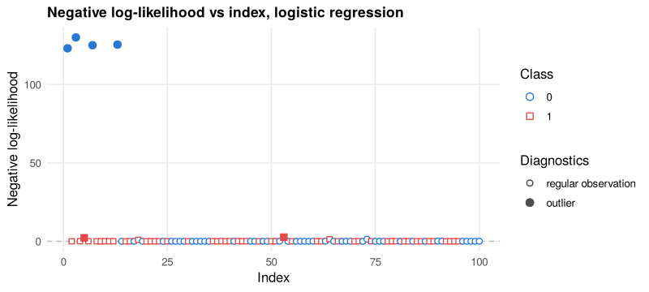
<p class="caption">plot of chunk bin-resid</p>
</div><div class="figure">
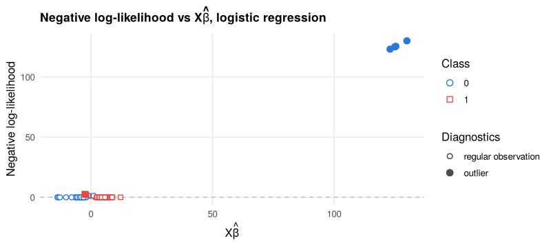
<p class="caption">plot of chunk bin-resid</p>
</div>

The diagnostic plot shows the observed response against $\hat\eta_i$, together with
the fitted logistic curve. The zoom panel shows the range of the regular
observations, where the S-shape of the logistic curve is visible.


```r
plotDiagnostic.enetLTS(fitb)
```

<div class="figure">
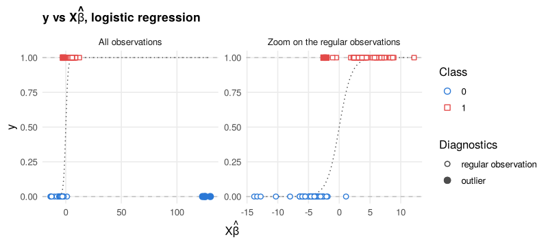
<p class="caption">plot of chunk bin-diag</p>
</div>

### Assessing the model on test data


```r
assess.enetLTS(fitb, BinomialExample$xtest, BinomialExample$ytest)
#> $deviance
#> reweighted        raw 
#>  0.4493500  0.4667908 
#> attr(,"measure")
#> [1] "Binomial Deviance"
#> 
#> $class
#> reweighted        raw 
#>      0.105      0.095 
#> attr(,"measure")
#> [1] "Misclassification Error"
#> 
#> $auc
#> reweighted        raw 
#>  0.9695860  0.9699929 
#> attr(,"measure")
#> [1] "AUC"
#> 
#> $mse
#> reweighted        raw 
#> 0.07017962 0.07044182 
#> attr(,"measure")
#> [1] "Mean-Squared Error"
#> 
#> $mae
#> reweighted        raw 
#>  0.1453057  0.1194645 
#> attr(,"measure")
#> [1] "Mean Absolute Error"
```

The `deviance` is twice the mean negative log-likelihood, as in `glmnet`. The
confusion matrix and the ROC curve of the reweighted fit:


```r
confusion.enetLTS(fitb, BinomialExample$xtest, BinomialExample$ytest)
#>          True
#> Predicted   0   1 Sum
#>       0    79  13  92
#>       1     8 100 108
#>       Sum  87 113 200
#> 
#>  Percent correct: 0.895
```


```r
roc.enetLTS(fitb, BinomialExample$xtest, BinomialExample$ytest, plot = TRUE)
```

<div class="figure">
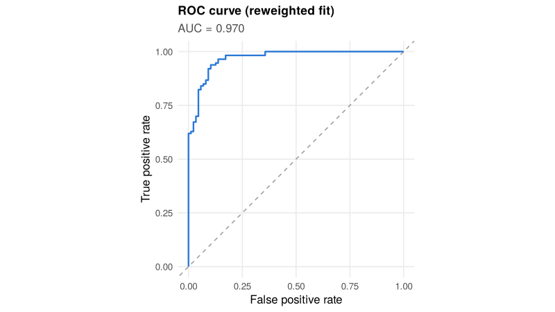
<p class="caption">plot of chunk bin-roc</p>
</div>

In simulations with this design (6 data sets) all contaminated observations were
flagged in every data set, and the test misclassification rate was about 0.10 for
enetLTS and about 0.49 for the classical elastic net.

## Multinomial regression: `family = "multinomial"`

### The model

Let $g_i \in \{1, \dots, K\}$ be the class label of observation $i$ and
$y_{il} = I(g_i = l)$ its indicator coding. Every class has an intercept and a
slope vector, and the scores (values of the linear link function) are
$z_{il} = \beta_{l0} + x_i^\top\beta_l$ for $l = 1, \dots, K$ (the linear
predictors $\eta_i$ of the logistic section, one per class). The class
probabilities are $p_l(x_i) = e^{z_{il}} / \sum_{j=1}^{K} e^{z_{ij}}$. The
parameters are not identifiable without a penalty (adding the same vector to all
$\beta_l$ leaves the probabilities unchanged); with a reference class $K$, the
coefficients $\beta_l - \beta_K$ are identified. The loss of observation $i$ is
the negative log-likelihood contribution

$$d_i = -\sum_{l=1}^{K} y_{il}\log p_l(x_i) = -\sum_{l=1}^{K} y_{il}\, z_{il} + \log\sum_{j=1}^{K} e^{z_{ij}},$$

where the second form follows from $\log p_l(x_i) = z_{il} - \log\sum_j e^{z_{ij}}$ and
$\sum_l y_{il} = 1$; it is the form used in the computations.
enetLTS minimizes the trimmed, penalized negative log-likelihood

$$\min_{|H|=h}\ \Big\{\sum_{i\in H} d_i + h\lambda P_\alpha(B)\Big\},
\qquad
P_\alpha(B) = \frac{1-\alpha}{2}\sum_{j=1}^{p}\sum_{l=1}^{K}\beta_{jl}^2 + \alpha\sum_{j=1}^{p}\sum_{l=1}^{K}|\beta_{jl}|,$$

where $B$ is the $(p+1)\times K$ coefficient matrix (Kurnaz and Filzmoser, 2023);
the penalty acts on the slopes of all $K$ classes and not on the intercepts. This
is the ungrouped penalty of `glmnet`; the grouped one is used with
`typegrouped = TRUE`. Kurnaz and Filzmoser (2023) write the loss as an average
over $H$ (factor $1/h$), as in the `glmnet` objective, with penalty $h\lambda P_\alpha$ as
printed in their Equation (5); the form above has the scale of $\lambda$ of the
`glmnet` objective, as in the code.

The subset is not chosen by this loss. In every C-step the centered scores are
decomposed by a singular value decomposition (of rank $r \le K-1$, because the
probabilities sum to one), and the observations of each class are ranked by the
robust Mahalanobis distance $RD(u_i)$ of their singular vectors $u_i$ (MCD
estimates of location and scatter within the class). The distances are scaled within the class so that their median equals the
$0.5$-quantile of the $\chi^2_r$ distribution,
$RD_s(u_i) = RD(u_i)\sqrt{\chi^2_{r,0.5}/\mathrm{median}\,RD(u_i)}$. The new subset
contains the $h_l$ observations of class $l$ with the smallest scaled distances,
so that the class proportions are kept. Kurnaz and Filzmoser (2023) apply the
decomposition to the scores of each class separately; the code applies it once to
the scores of all observations. The code uses
$h_l = \lfloor n_l \cdot \texttt{hsize} + 1\rfloor$ and $h = \sum_l h_l$; the paper
defines $h_l = (n_l + 1)h/n$, adjusted so that $\sum_l h_l = h$. The
formula above is the elastic net fit on the retained subset.

### The data

`MultinomialExample` has $n = 150$ observations, $p = 200$ predictors and $K = 3$
classes; each class is driven by its own two predictors. The first 15
observations are bad leverage points: predictors 1 and 2, which point to class 1,
are shifted by 5, and the label is set to class 3.


```r
data(MultinomialExample)
xm <- MultinomialExample$x
ym <- MultinomialExample$y
table(ym)
#> ym
#>  1  2  3 
#> 53 43 54
fitm <- enetLTS(xm, ym, family = "multinomial", seed = 1)
fitm
#> enetLTS estimator (family = "multinomial", reweighted fit)
#> 
#> Call: enetLTS(xx = xm, yy = ym, family = "multinomial", seed = 1)
#> 
#> Nonzero coefficients (39 of 200 predictors in at least one class):
#>                   1       2       3
#> (Intercept)  0.1928 -0.0075 -0.0047
#> x1           0.8128  0.0000  0.0000
#> x2           0.8239  0.0000  0.0000
#> x3          -0.1525  0.9210  0.0000
#> x4           0.0000  0.9482  0.0000
#> x5           0.0000  0.0000  1.1420
#> x6           0.0000  0.0000  0.7731
#> x11          0.0000  0.2065  0.0000
#> x24          0.0000  0.1286  0.0000
#> x34          0.0000  0.0000  0.1890
#> x36          0.0255  0.0000  0.0000
#> x44          0.0000  0.0000 -0.0328
#> x47          0.1306  0.0000  0.0000
#> x49         -0.0876  0.0000  0.0000
#> x67          0.0000  0.0000  0.0217
#> x72         -0.2807  0.0000  0.0000
#> x77         -0.1855  0.0000  0.2084
#> x86          0.0000  0.0000 -0.0086
#> x87          0.0143  0.0000  0.0000
#> x88          0.0000  0.1805  0.0000
#> ... 20 more rows; see coef(x)
#> 
#> alpha = 1, lambda = 0.009536, lambdaw = 0.03737
#> Observations flagged as outliers: 16 of 150 (see outliers.enetLTS())
```

The printed matrix has one column per class; a row is shown when the predictor
has a nonzero coefficient in at least one class.

### Outliers


```r
om <- outliers.enetLTS(fitm)
om
#> enetLTS outliers (reweighted fit, multinomial): 16 of 150 observations flagged
#>  index   loss observed predicted                          type
#>      1 10.465        3         1 bad leverage point (screened)
#>      2  7.341        3         1 bad leverage point (screened)
#>      3  8.254        3         1 bad leverage point (screened)
#>      4  8.049        3         1 bad leverage point (screened)
#>      5  7.953        3         1 bad leverage point (screened)
#>      6  9.453        3         1 bad leverage point (screened)
#>      7 10.172        3         1 bad leverage point (screened)
#>      8  7.719        3         1 bad leverage point (screened)
#>      9  5.161        3         1 bad leverage point (screened)
#>     10  9.532        3         1 bad leverage point (screened)
#>     11 10.070        3         1 bad leverage point (screened)
#>     12  7.746        3         1 bad leverage point (screened)
#>     13 11.214        3         1 bad leverage point (screened)
#>     14  9.305        3         1 bad leverage point (screened)
#>     15  5.251        3         1 bad leverage point (screened)
#>     56  0.115        1         1     leverage point (screened)
outm <- MultinomialExample$outliers
list(detected = intersect(om$index[om$flagged], outm),
     missed = setdiff(outm, om$index[om$flagged]),
     clean_but_flagged = setdiff(om$index[om$flagged], outm))
#> $detected
#>  [1]  1  2  3  4  5  6  7  8  9 10 11 12 13 14 15
#> 
#> $missed
#> integer(0)
#> 
#> $clean_but_flagged
#> [1] 56
```

All 15 contaminated observations are flagged. Observations that are
outlying in the predictors are screened before the fit,
without using the labels (`screen = TRUE`); they are listed as
`bad leverage point (screened)` (classified differently from the observed class) or
`leverage point (screened)`, and stored in `fitm$screened`. The screening uses a
97.5% cut-off of a robust distance, so a few clean observations may be screened as
well. Here this happened to observation
56, which is
classified correctly and therefore listed as `leverage point (screened)`.

### Arguments specific to multinomial regression

| Argument | Default | Meaning |
|---|---|---|
| `yy` | – | A factor (or a vector of class labels) with $K \ge 3$ classes, or an $n \times K$ indicator matrix. |
| `lambdas` | 20 values | Log-spaced from the largest useful $\lambda$ (lasso, robustly standardized data) down to 1% of it. |
| `screen` | `TRUE` | Leaves out observations that are outlying in the predictors before the fit, without using the labels; they are listed in `$screened`. |
| `crossfit` | `TRUE` | Chooses the retained observations by cross-fitted losses, so an observation is never judged by a model that has seen it. |
| `del` | `0.0125` | The reweighting flags an observation when the cross-fitted probability of its observed class falls below a cut-off calibrated to flag about `2*del` (2.5%) of the observations if the model is correct. |
| `typegrouped` | `FALSE` | Use a grouped lasso penalty (all $K$ coefficients of a predictor enter or leave together) in the fits after the subset search. |

An alternative reweighting rule (a robust median/MAD bound on the cross-fitted loss within each class) can be used with
`options(enetLTS.wrule = "mad")`.

### Plots

The coefficient plot has one panel per class. The largest coefficients are those
of the true predictors: 1 and 2 for class 1, 3 and 4 for class 2, and 5 and 6 for
class 3.


```r
plotCoef.enetLTS(fitm)
```

<div class="figure">
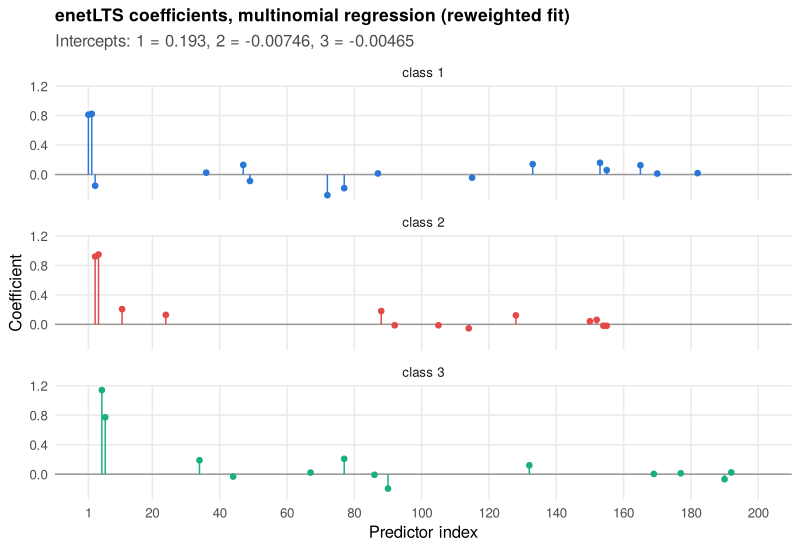
<p class="caption">plot of chunk mult-coef</p>
</div>

The residual plot shows the negative log-likelihood of every observation against
its index.


```r
plotResid.enetLTS(fitm, zoom = FALSE)
```

<div class="figure">
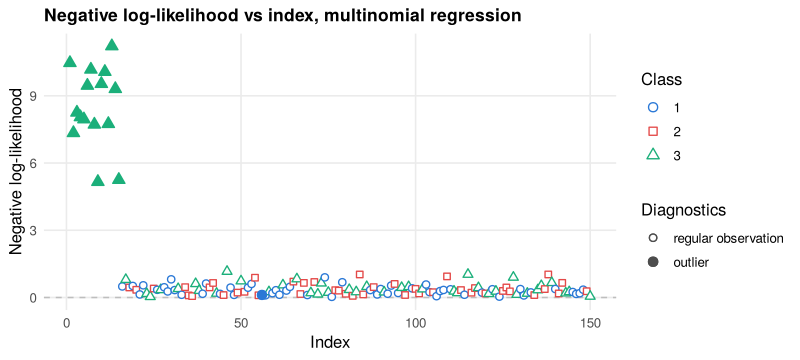
<p class="caption">plot of chunk mult-resid</p>
</div>

The diagnostic plot shows the first two components of the estimated scores.


```r
plotDiagnostic.enetLTS(fitm)
```

<div class="figure">
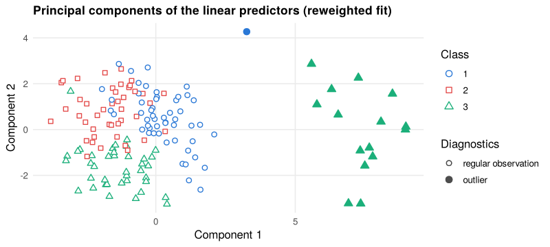
<p class="caption">plot of chunk mult-diag</p>
</div>

### Assessing the model on test data


```r
assess.enetLTS(fitm, MultinomialExample$xtest, MultinomialExample$ytest)
#> $deviance
#> reweighted        raw 
#>   1.136182   1.351575 
#> attr(,"measure")
#> [1] "Multinomial Deviance"
#> 
#> $class
#> reweighted        raw 
#>  0.2066667  0.2966667 
#> attr(,"measure")
#> [1] "Misclassification Error"
#> 
#> $mse
#> reweighted        raw 
#>  0.3266918  0.4005329 
#> attr(,"measure")
#> [1] "Mean-Squared Error"
#> 
#> $mae
#> reweighted        raw 
#>  0.7724546  0.7083629 
#> attr(,"measure")
#> [1] "Mean Absolute Error"
confusion.enetLTS(fitm, MultinomialExample$xtest, MultinomialExample$ytest)
#>          True
#> Predicted   1   2   3 Sum
#>       1    76  19  17 112
#>       2     8  77   7  92
#>       3     6   5  85  96
#>       Sum  90 101 109 300
#> 
#>  Percent correct: 0.7933
```

The overall share of correct classifications hides differences between the
classes. The share of each true class that is recognized:


```r
pm <- predict(fitm, newX = MultinomialExample$xtest, type = "class")$class
round(tapply(pm == MultinomialExample$ytest, MultinomialExample$ytest, mean), 3)
#>     1     2     3 
#> 0.844 0.762 0.780
```

## Choosing `hsize`

`hsize` is the fraction of observations used by the trimmed fit; the estimator can
cope with up to about $1-$`hsize` contamination. The default `0.75` is a common
compromise between robustness and efficiency. When the amount of contamination is
unknown, `hsize = "optimal"` (experimental) fits all values in `hgrid` and selects
one of them as follows. For each value the model is fitted; then, in a repeated
5-fold cross-validation (2 repetitions), the model is refitted on the retained
observations of that fit outside the test fold, and the loss (squared error for
`"gaussian"`, negative log-likelihood otherwise) is computed for **all**
observations of the test fold. The criterion is the mean of the smallest 75% of
these cross-validated losses, so the outliers, which have large losses, do not
decide. The selected value is the **largest** `hsize` whose criterion is within 10%
of the smallest one, which favors efficiency when several values are about
equally good. A warning is issued when the selected value is below 0.7. Since the
worst 25% of the losses are ignored, the criterion cannot be relied on when more
than about a quarter of the data are contaminated. This option is experimental:
use it as a guide and compare the result with a fixed `hsize`.


```r
fit.opt <- enetLTS(x, y, hsize = "optimal", seed = 1)
```

## Practical interpretation and limitations

* **Flagged is not wrong.** An observation is flagged when it is inconsistent with the
  fitted model. In regression these are outliers in the response or the predictors.
  In classification, a flagged observation can have a wrong label, but it can also be
  a correctly labeled observation with an unlikely label; in noisy data a share of
  such observations is expected, and `type` only marks candidates.
* **`outliers.enetLTS()` is a diagnostic, not a universal outlier detector.** What it
  reports depends on the version (`"raw"` or `"reweighted"`) and on the fitted model.
  Remote observations that the model fits well (good leverage points) are not
  flagged by the reweighted fit; compare with `vers = "raw"`.
* **Moderate outliers in high dimensions.** The examples above contain gross
  outliers. When outliers are only moderately shifted and lie in a few of many
  predictors, they are harder to separate from the clean data, and some of them
  may not be flagged.
* **Check the tuning.** Compare a few values of `hsize`, and look at the plots before
  interpreting the coefficients.

## Output components

`enetLTS()` returns a list of class `"enetLTS"`. The most important components:

| Component | Meaning |
|---|---|
| `coefficients`, `raw.coefficients` | Reweighted and raw coefficients (intercept first). |
| `alpha`, `lambda`, `lambdaw` | Selected tuning parameters (raw fit, reweighted fit). |
| `wt`, `raw.wt` | 0/1 weights; 0 marks a flagged observation. |
| `best` | Indices of the best subset of the raw fit. |
| `fitted.values`, `residuals` | On the training data (reweighted fit). |
| `screened` | Multinomial family: observations removed by the screening. |
| `inputs` | The data and the arguments of the call. |

## References

Hastie, T., Qian, J. and Tay, K. (2026). An Introduction to `glmnet`. Vignette of
the R package `glmnet`. https://glmnet.stanford.edu/articles/glmnet.html
(accessed 16 November 2026).

Kurnaz, F. S. and Filzmoser, P. (2023). enetLTS: Robust and sparse methods for
high dimensional linear, binary, and multinomial regression. *Journal of Open
Source Software*, 8(82), 4773. doi:10.21105/joss.04773

Kurnaz, F. S. and Filzmoser, P. (2023). Robust and sparse multinomial
regression in high dimensions. *Data Mining and Knowledge Discovery*, 37(4),
1609--1629. doi:10.1007/s10618-023-00936-6

Kurnaz, F. S., Hoffmann, I. and Filzmoser, P. (2018). Robust and sparse
estimation methods for high-dimensional linear and logistic regression.
*Chemometrics and Intelligent Laboratory Systems*, 172, 211--222.
doi:10.1016/j.chemolab.2017.11.017

Alfons, A., Croux, C. and Gelper, S. (2013). Sparse least trimmed squares
regression for analyzing high-dimensional large data sets. *The Annals of
Applied Statistics*, 7, 226--248.

Friedman, J., Hastie, T. and Tibshirani, R. (2010). Regularization paths for
generalized linear models via coordinate descent. *Journal of Statistical
Software*, 33(1), 1--22.

Croux, C. and Haesbroeck, G. (2003). Implementing the Bianco and Yohai estimator
for logistic regression. *Computational Statistics & Data Analysis*, 44, 273--295.
